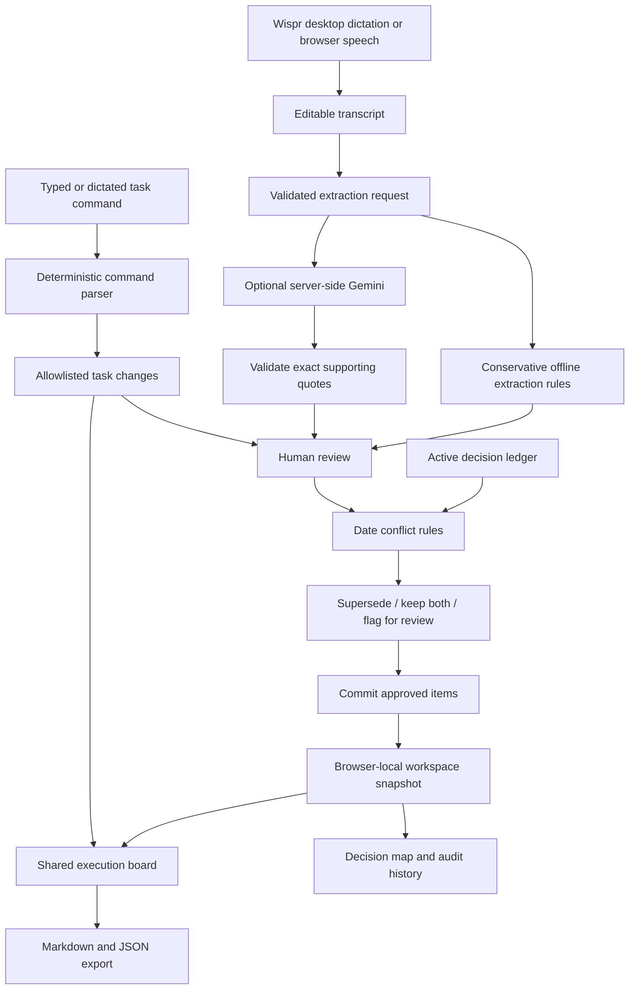

# Decisio architecture

## App-owned behavior

- `shared/engine.js`: explicit offline commitments; active dated-decision comparison; command parsing; immutable task updates; validated review commits and supersession history.
- `shared/export.js`: current-state exports, excluding rejected tasks and superseded agreements.
- `src/App.jsx`: one workspace snapshot for all views. Draft review and selected conflict resolutions are saved along with the ledger, tasks, and audit.
- `src/components/MeetingReview.jsx`: side-by-side source comparison and task editing. Conflict resolution is staged until commit.
- `src/components/DecisionMap.jsx`: explicit supersession arrows and meeting-origin groups. It does not invent task dependencies.
- `src/components/useSpeech.js`: browser microphone lifecycle, final-only results, explicit stop and cleanup. Spoken commands populate the field for submission.

## Hosting

The original React/Vite project is retained. `scripts/build-hosted.mjs` builds the frontend and bundles a portable Worker API with embedded frontend assets. `worker/index.js` serves the application and API on the same origin; Express remains the local development adapter. API keys are read only on the server.

`npm run build` makes a static frontend. `npm run build:hosted` makes the complete deployment under `dist/server/index.js` and `dist/.openai/hosting.json`.

## Limits

This release saves data in the current browser, not a shared team database. Clearing site data removes that workspace. JSON export is a snapshot, not a restore feature. Offline extraction recognizes explicit phrases; nuanced ownership changes, relative-date normalization, and semantic reversals need manual review or AI assistance. The conflict engine currently identifies dated changes on matching topics, not arbitrary semantic contradictions. Wispr Flow is external desktop dictation, not an SDK integration. Browser microphone availability depends on the browser and permissions.
